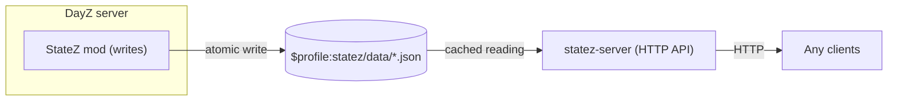

# StateZ

StateZ exposes the live state of a DayZ world over a simple read-only HTTP API. It has two parts - a server-side
DayZ mod that writes JSON snapshots to disk, and `statez-server`, a small Go HTTP API server that reads those
snapshots and serves them to whatever wants them - a live map, a Telegram/Discord bot, an admin dashboard, your own
scripts.

## Why

The vanilla DayZ server only speaks A2S and RCon. Those are good for server discovery and player management, but
they say almost nothing about the world itself - where players and vehicles are, how many zombies are alive, what
is happening with bases or weapons. StateZ collects that data inside the server and makes it available to other
tools.

The mod is based on [WoozyMasta/metricz](https://github.com/WoozyMasta/metricz), which exports Prometheus metrics.
This "fork" keeps its collection approach (time-sliced, event-driven counters, minimal per-frame work) and replaces
the Prometheus output with plain JSON files with some extras.

## How it works



- The mod runs 10 collectors (animals, areas, events, hits, players, territories, vehicles, weapons, zombies,
  world). It runs one collector per server frame, so there is no single heavy tick
- World counts (zombies, vehicles, weapons, etc.) are kept up to date by `EEInit`/`EEDelete` hooks, not by scanning
  all entities
- Files are written atomically (`.tmp` then replace), and only when the content actually changed.
- The mod writes raw values
- The server caches each file in memory and re-reads it only when its size or modification time changes. It converts
  `0`/`1` to `true`/`false` and returns its own response model, not the mod's format (two formats are separate
  contracts, so each can change without breaking the other)

## Mod: installing and configuring

The mod is server-side only. **Clients need nothing installed**.

> TODO: installation from GitHub Releases. Update once the CI that publishes releases is ready.

Start the server with `-serverMod=@statez`:

```bash
cd /path/to/dayz-server && ./DayZServer -config=serverDZ.cfg -serverMod=@statez
```

Notes:

* Use exactly `-serverMod=@statez`, not `-mod=@statez`
* The PBO is unsigned, so set `verifySignatures=0;` in your server config

Config is created on first run at `$profile:statez/config.json`:

| Key                             | Default | Meaning                                                                     |
|---------------------------------|---------|-----------------------------------------------------------------------------|
| `interval`                      | `5`     | Seconds between collection cycles (clamped to 0-900)                        |
| `delete_on_shutdown`            | `true`  | Delete the JSON files on shutdown. Set `false` to inspect them after a stop |
| `thresholds.hit_damage`         | `3`     | Minimum damage to record a hit. `-1` disables the threshold                 |
| `thresholds.hit_damage_vehicle` | `15`    | Minimum vehicle damage to record a hit. `-1` disables the threshold         |

Snapshots go to `$profile:statez/data/`. To store them elsewhere, replace that directory with a symlink.

Positions use map axes - `pos_x` is engine X, `pos_y` is engine Z, `pos_alt` is engine Y, and `pos_angle` is yaw in
degrees.

### Uninstalling

1. Stop the server, remove `-serverMod=@statez` from your launch command, then delete the mod -
   `rm -rv /path/to/dayz-server/@statez`
2. Remove the config and snapshots. `$profile` is your server profiles directory (`-profiles`) -
   `rm -rv /path/to/profiles/statez`

The mod deletes `data/*.json` on graceful shutdown when `delete_on_shutdown` is `true`. It never deletes `config.json`,
so step 2 is the only way to remove that file.

## Server: installing and starting `statez-server`

Place the binary at `/usr/local/bin/statez-server` first, then create a system user and the config file (run
everything as root):

```bash
useradd --system --no-create-home --shell /usr/sbin/nologin statez
install -d -m 0755 /etc/statez-server
echo 'STATEZ_SERVER_LISTEN=127.0.0.1:8080' > /etc/statez-server/.env
echo 'STATEZ_SERVER_MOD_DATA_DIR=/path/to/statez/data' >> /etc/statez-server/.env
echo 'STATEZ_SERVER_API_TOKEN=!!!CHANGE_ME!!!' >> /etc/statez-server/.env
chown root:statez /etc/statez-server/.env
chmod 0640 /etc/statez-server/.env
```

The `statez` user must be able to read the data directory. Make the `statez` group the owner of the data, give it read
access, make new files inherit the group (`g+s`), and grant traverse (`x`) on every parent directory (list all of them,
e.g. `/path` and `/path/to`):

```bash
chgrp -R statez /path/to/statez/data
chmod -R g+rX /path/to/statez/data
chmod g+s /path/to/statez/data
chmod o+x /path /path/to
```

New files keep the permissions of the process that writes them, so it must use a umask that allows group read
(e.g. `022`).

Check that `statez` can read the data:

```bash
runuser -u statez -- ls -l /path/to/statez/data
runuser -u statez -- cat /path/to/statez/data/world.json
```

Create the unit file `/etc/systemd/system/statez-server.service`:

```ini
[Unit]
Description=StateZ server
After=network-online.target
Wants=network-online.target

[Service]
User=statez
Group=statez
EnvironmentFile=/etc/statez-server/.env
ExecStart=/usr/local/bin/statez-server
Restart=on-failure

[Install]
WantedBy=multi-user.target
```

Start the service:

```bash
systemctl daemon-reload
systemctl enable --now statez-server
systemctl status statez-server
journalctl -u statez-server -n 50 --no-pager
```

Check it (use the token from `.env`):

```bash
curl -i http://127.0.0.1:8080/healthz
curl -i -H "Authorization: Bearer !!!CHANGE_ME!!!" http://127.0.0.1:8080/world
```

### Logs

Logs go to journald:

```bash
journalctl -u statez-server -f
journalctl -u statez-server --since "1 hour ago" --no-pager
```

Log size is limited by journald settings, not by StateZ. See `journald.conf(5)`, for example `SystemMaxUse=` in
`/etc/systemd/journald.conf`.

### Uninstalling

```bash
systemctl disable --now statez-server
rm /etc/systemd/system/statez-server.service /usr/local/bin/statez-server
rm -r /etc/statez-server
systemctl daemon-reload
userdel statez
```

## Server configuration

Flags and environment variables. Environment variables override flags.

| Flag            | Env                          | Default          | Meaning                                                        |
|-----------------|------------------------------|------------------|----------------------------------------------------------------|
| `-listen`       | `STATEZ_SERVER_LISTEN`       | `0.0.0.0:8080`   | Address to listen on                                           |
| `-mod-data-dir` | `STATEZ_SERVER_MOD_DATA_DIR` | required         | The mod's `$profile:statez/data/` directory                    |
| `-api-token`    | `STATEZ_SERVER_API_TOKEN`    | empty (auth off) | Token for all endpoints except `/healthz`                      |
| `-tls-cert`     | `STATEZ_SERVER_TLS_CERT`     | empty            | Certificate file. Set together with `--tls-key` to serve HTTPS |
| `-tls-key`      | `STATEZ_SERVER_TLS_KEY`      | empty            | Private key file                                               |

## API

All endpoints are `GET` and return JSON. Each one returns the latest snapshot written by the mod. Send the token as
`Authorization: Bearer <token>` or `X-API-Key: <token>`. `/healthz` and `/` do not need a token.

| Endpoint       | Returns                                                                                                                                        |
|----------------|------------------------------------------------------------------------------------------------------------------------------------------------|
| `/`            | JSON index of all endpoints                                                                                                                    |
| `/animals`     | Alive animals per type                                                                                                                         |
| `/areas`       | Effect areas (static gas zones and dynamic events): type, center, radius, players inside                                                       |
| `/events`      | Engine event counters since server start - connects, disconnects, deaths, chat, etc.                                                           |
| `/hits`        | Hit counts since server start, split by player/creature and ammo type                                                                          |
| `/players`     | Every online player - identity, character, position, vitals, state flags, network and lifetime stats                                           |
| `/territories` | Base territory flags - position, refresh-timer fraction, radius                                                                                |
| `/vehicles`    | Every tracked vehicle - class, position, health, crew, engine, lights, fuel, coolant, cargo count, per-part health                             |
| `/weapons`     | Shots per weapon type, live weapon entity counts, kills by source                                                                              |
| `/world`       | Map name, uptime, in-game clock, population counts, vehicle counts, loot and entity breakdowns, server FPS, weather, food/mining/fishing stats |
| `/zombies`     | Infected count per type and per AI state (calm, disturbed, alerted, chase, fight, dead)                                                        |
| `/healthz`     | Liveness probe, always `200`                                                                                                                   |

Response headers on data endpoints: `X-Cache-Hit` (served from cache), `Last-Modified` (mod file time), and
`X-Data-Age-Seconds` (how old the data is).

Example:

```bash
curl -s -H "Authorization: Bearer $STATEZ_TOKEN" http://127.0.0.1:8080/world
```

## Licence

* Mod (`mod/`): GPL-3.0-or-later (see `mod/LICENSE`). It is based on WoozyMasta/metricz, Copyright (c) WoozyMasta.
* Server (`server/`): MIT.

## Releases

> TODO: binaries and the mod PBO will be published on GitHub Releases. Update this section once the CI pipeline is
ready.
