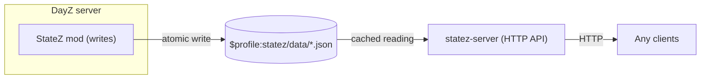

# StateZ

StateZ exposes the live state of a DayZ world over a simple read-only HTTP API. It has two parts - a server-side
DayZ mod that writes JSON snapshots to disk, and `statez-server`, a small Go HTTP API server that reads those
snapshots and serves them to whatever wants them - a live map, a Telegram/Discord bot, an admin dashboard, your own
scripts.

## Why

The vanilla DayZ server only speaks A2S and RCon. Those are good for server discovery and player management, but
they say almost nothing about the world itself - where players and vehicles are, how many zombies are alive, what
is happening with bases or weapons. StateZ collects that data inside the server and makes it available to other
tools.

The mod is based on [WoozyMasta/metricz](https://github.com/WoozyMasta/metricz), which exports Prometheus metrics.
This "fork" keeps its collection approach (time-sliced, event-driven counters, minimal per-frame work) and replaces
the Prometheus output with plain JSON files with some extras.

## How it works

- The mod runs 10 collectors (animals, areas, events, hits, players, territories, vehicles, weapons, zombies,
  world). It runs one collector per server frame, so there is no single heavy tick
- World counts (zombies, vehicles, weapons, etc.) are kept up to date by `EEInit`/`EEDelete` hooks, not by scanning
  all entities
- Files are written atomically (`.tmp` then replace), and only when the content actually changed.
- The mod writes raw values
- The server caches each file in memory and re-reads it only when its size or modification time changes. It converts
  `0`/`1` to `true`/`false` and returns its own response model, not the mod's format (two formats are separate
  contracts, so each can change without breaking the other)

## Installing

StateZ has two parts, installed independently:

- **Mod** (DayZ server-side) - see [`mod/README.md`](mod/README.md) for installing and configuring it.
- **Server** (`statez-server` HTTP API) - see [`server/README.md`](server/README.md) for installing, configuration
  flags and the HTTP API reference.
